# 刺客信条：历代主作城市图集

**18 个城市场景，英文版 18 张 + 中文版 18 张，共 36 张。** 沿用风格 3「高细节城市微缩海报」，均由内置 `image_gen` 生成或编辑，原图为 1122 × 1402 PNG。

图集以原有 14 部主作各一座代表城市为基础，补充《刺客信条 II》的威尼斯、初代的大马士革与阿卡、《黑旗》的拿骚。中文版逐张以英文原图为编辑目标，替换城市名、游戏名和年代说明；城市构图与色彩基本保留，生成式编辑仍可能带来细节变化。

[仅看中文版](assassins-creed-cities-zh.md) · [首批 14 张英文提示词](assassins-creed-city-prompts.json) · [新增四城与全部中文提示词](assassins-creed-expansion-prompts.json) · [作品清单与校验](assassins-creed-cities.json)

图像为游戏背景启发的艺术化微缩表现，压缩城市地理关系，不作为游戏地图复刻或考古复原。年份为选取的场景时间点。《英灵殿》的 Lunden 采用“伦敦城”标题，和《枭雄》1868 年的伦敦区分。

## 作品目录

| 编号 | 主作 | 城市 | 场景年代 | 原图 |
| --- | --- | --- | --- | --- |
| 01 | 刺客信条 | 耶路撒冷 | 圣地 · 1191年 | [中文](../images/city-miniature-posters/ac-01-jerusalem-zh.png) · [英文](../images/city-miniature-posters/ac-01-jerusalem.png) |
| 02 | 刺客信条 II | 佛罗伦萨 | 意大利 · 1476年 | [中文](../images/city-miniature-posters/ac-02-florence-zh.png) · [英文](../images/city-miniature-posters/ac-02-florence.png) |
| 03 | 刺客信条：兄弟会 | 罗马 | 意大利 · 1500年 | [中文](../images/city-miniature-posters/ac-03-rome-zh.png) · [英文](../images/city-miniature-posters/ac-03-rome.png) |
| 04 | 刺客信条：启示录 | 君士坦丁堡 | 奥斯曼帝国 · 1511年 | [中文](../images/city-miniature-posters/ac-04-constantinople-zh.png) · [英文](../images/city-miniature-posters/ac-04-constantinople.png) |
| 05 | 刺客信条 III | 波士顿 | 北美殖民地 · 1773年 | [中文](../images/city-miniature-posters/ac-05-boston-zh.png) · [英文](../images/city-miniature-posters/ac-05-boston.png) |
| 06 | 刺客信条 IV：黑旗 | 哈瓦那 | 加勒比海 · 1715年 | [中文](../images/city-miniature-posters/ac-06-havana-zh.png) · [英文](../images/city-miniature-posters/ac-06-havana.png) |
| 07 | 刺客信条：叛变 | 纽约 | 北美殖民地 · 1756年 | [中文](../images/city-miniature-posters/ac-07-new-york-zh.png) · [英文](../images/city-miniature-posters/ac-07-new-york.png) |
| 08 | 刺客信条：大革命 | 巴黎 | 法国 · 1789年 | [中文](../images/city-miniature-posters/ac-08-paris-zh.png) · [英文](../images/city-miniature-posters/ac-08-paris.png) |
| 09 | 刺客信条：枭雄 | 伦敦 | 英格兰 · 1868年 | [中文](../images/city-miniature-posters/ac-09-london-zh.png) · [英文](../images/city-miniature-posters/ac-09-london.png) |
| 10 | 刺客信条：起源 | 亚历山大 | 托勒密埃及 · 公元前48年 | [中文](../images/city-miniature-posters/ac-10-alexandria-zh.png) · [英文](../images/city-miniature-posters/ac-10-alexandria.png) |
| 11 | 刺客信条：奥德赛 | 雅典 | 古希腊 · 公元前431年 | [中文](../images/city-miniature-posters/ac-11-athens-zh.png) · [英文](../images/city-miniature-posters/ac-11-athens.png) |
| 12 | 刺客信条：英灵殿 | 伦敦城 | 盎格鲁－撒克逊英格兰 · 873年 | [中文](../images/city-miniature-posters/ac-12-lunden-zh.png) · [英文](../images/city-miniature-posters/ac-12-lunden.png) |
| 13 | 刺客信条：幻景 | 巴格达 | 阿拔斯王朝 · 861年 | [中文](../images/city-miniature-posters/ac-13-baghdad-zh.png) · [英文](../images/city-miniature-posters/ac-13-baghdad.png) |
| 14 | 刺客信条：影 | 京都 | 战国日本 · 1579年 | [中文](../images/city-miniature-posters/ac-14-kyoto-zh.png) · [英文](../images/city-miniature-posters/ac-14-kyoto.png) |
| 15 | 刺客信条 II | 威尼斯 | 威尼斯共和国 · 1486年 | [中文](../images/city-miniature-posters/ac-15-venice-zh.png) · [英文](../images/city-miniature-posters/ac-15-venice.png) |
| 16 | 刺客信条 | 大马士革 | 叙利亚 · 1191年 | [中文](../images/city-miniature-posters/ac-16-damascus-zh.png) · [英文](../images/city-miniature-posters/ac-16-damascus.png) |
| 17 | 刺客信条 | 阿卡 | 圣地 · 1191年 | [中文](../images/city-miniature-posters/ac-17-acre-zh.png) · [英文](../images/city-miniature-posters/ac-17-acre.png) |
| 18 | 刺客信条 IV：黑旗 | 拿骚 | 巴哈马 · 1715年 | [中文](../images/city-miniature-posters/ac-18-nassau-zh.png) · [英文](../images/city-miniature-posters/ac-18-nassau.png) |

## 中英文对照

### 01 · 耶路撒冷 · 刺客信条

| 中文版 | 英文版 |
| --- | --- |
|  |  |

[中文编辑提示词](../prompts/city-miniature-poster/ac-01-jerusalem-zh.json) · [英文生成提示词](../prompts/city-miniature-poster/ac-01-jerusalem.json)

### 02 · 佛罗伦萨 · 刺客信条 II

| 中文版 | 英文版 |
| --- | --- |
|  |  |

[中文编辑提示词](../prompts/city-miniature-poster/ac-02-florence-zh.json) · [英文生成提示词](../prompts/city-miniature-poster/ac-02-florence.json)

### 03 · 罗马 · 刺客信条：兄弟会

| 中文版 | 英文版 |
| --- | --- |
| <a href="../images/city-miniature-posters/ac-03-rome-zh.png">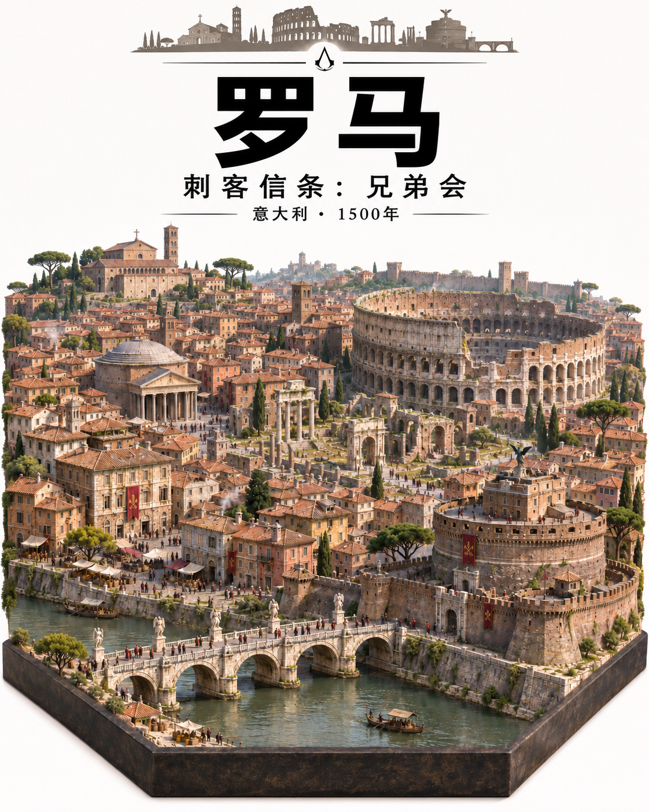</a> |  |

[中文编辑提示词](../prompts/city-miniature-poster/ac-03-rome-zh.json) · [英文生成提示词](../prompts/city-miniature-poster/ac-03-rome.json)

### 04 · 君士坦丁堡 · 刺客信条：启示录

| 中文版 | 英文版 |
| --- | --- |
| <a href="../images/city-miniature-posters/ac-04-constantinople-zh.png">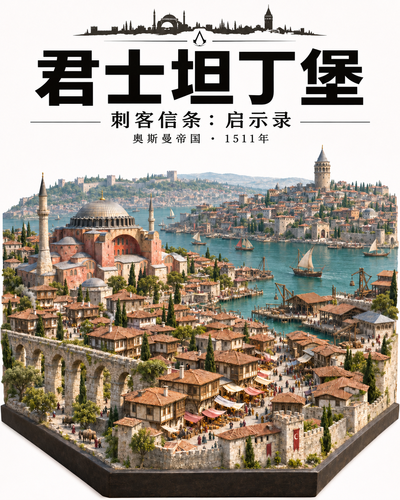</a> |  |

[中文编辑提示词](../prompts/city-miniature-poster/ac-04-constantinople-zh.json) · [英文生成提示词](../prompts/city-miniature-poster/ac-04-constantinople.json)

### 05 · 波士顿 · 刺客信条 III

| 中文版 | 英文版 |
| --- | --- |
| <a href="../images/city-miniature-posters/ac-05-boston-zh.png">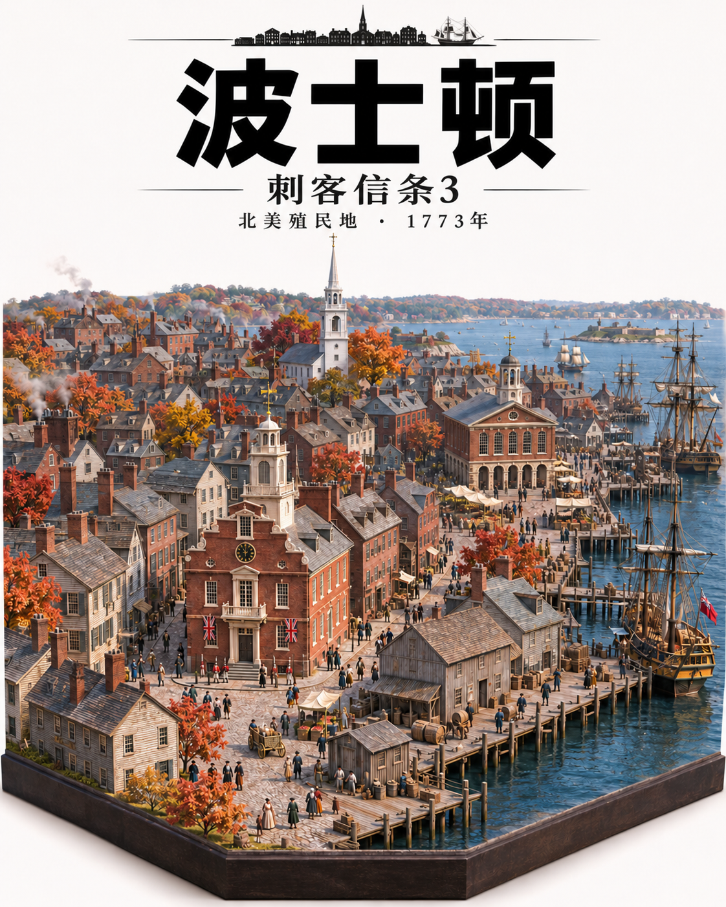</a> | <a href="../images/city-miniature-posters/ac-05-boston.png">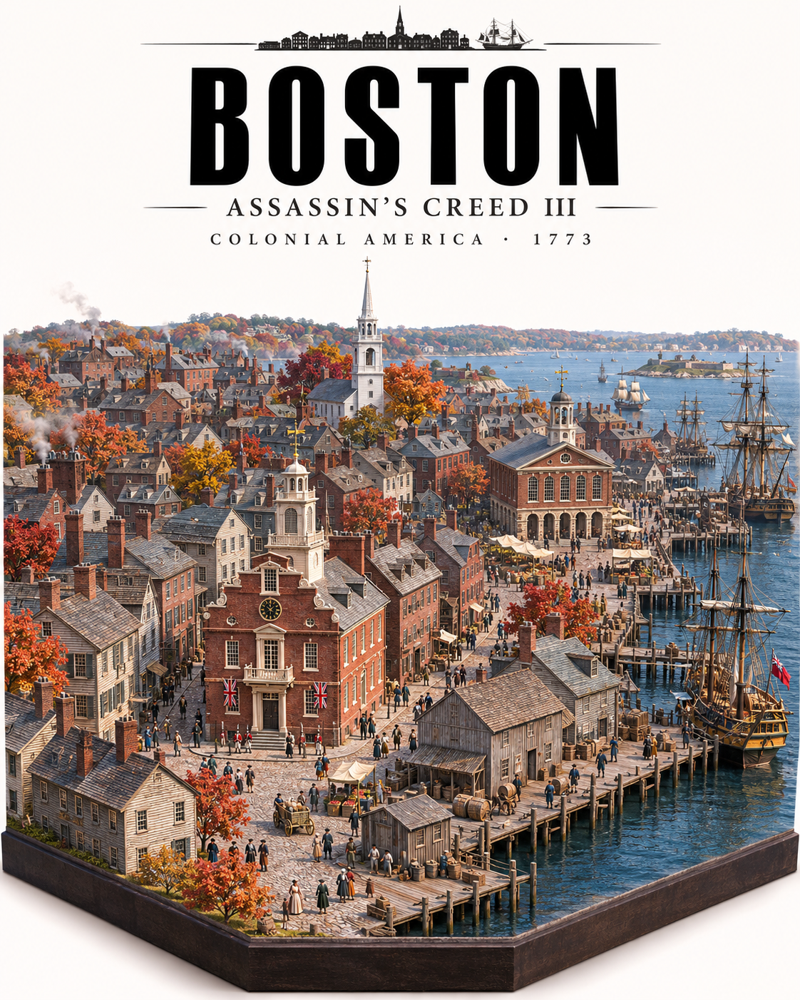</a> |

[中文编辑提示词](../prompts/city-miniature-poster/ac-05-boston-zh.json) · [英文生成提示词](../prompts/city-miniature-poster/ac-05-boston.json)

### 06 · 哈瓦那 · 刺客信条 IV：黑旗

| 中文版 | 英文版 |
| --- | --- |
| <a href="../images/city-miniature-posters/ac-06-havana-zh.png">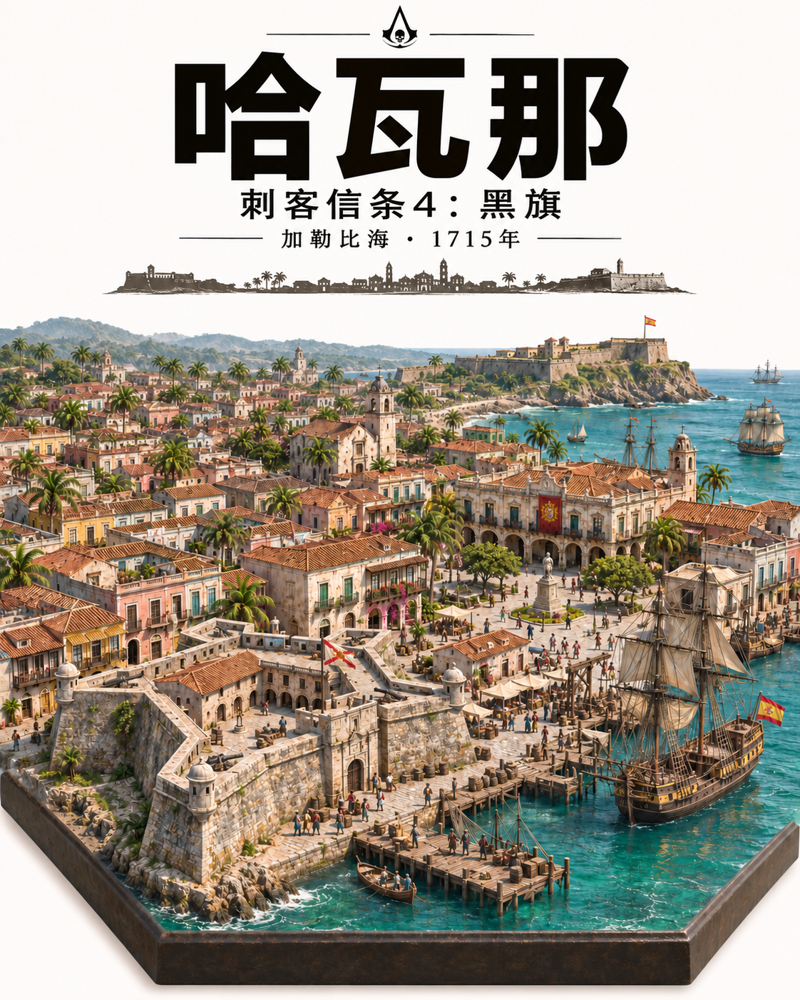</a> | <a href="../images/city-miniature-posters/ac-06-havana.png">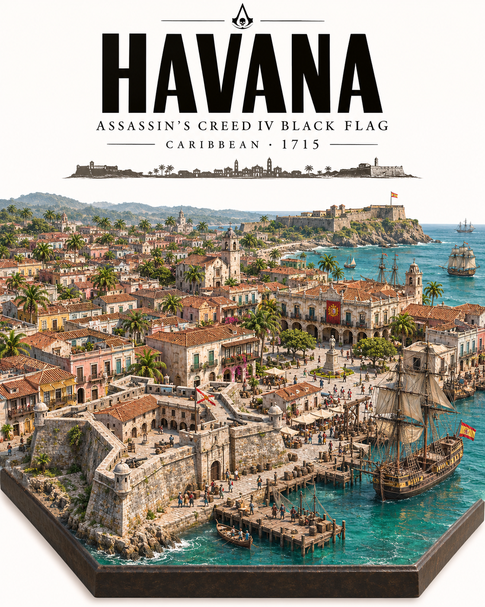</a> |

[中文编辑提示词](../prompts/city-miniature-poster/ac-06-havana-zh.json) · [英文生成提示词](../prompts/city-miniature-poster/ac-06-havana.json)

### 07 · 纽约 · 刺客信条：叛变

| 中文版 | 英文版 |
| --- | --- |
| <a href="../images/city-miniature-posters/ac-07-new-york-zh.png">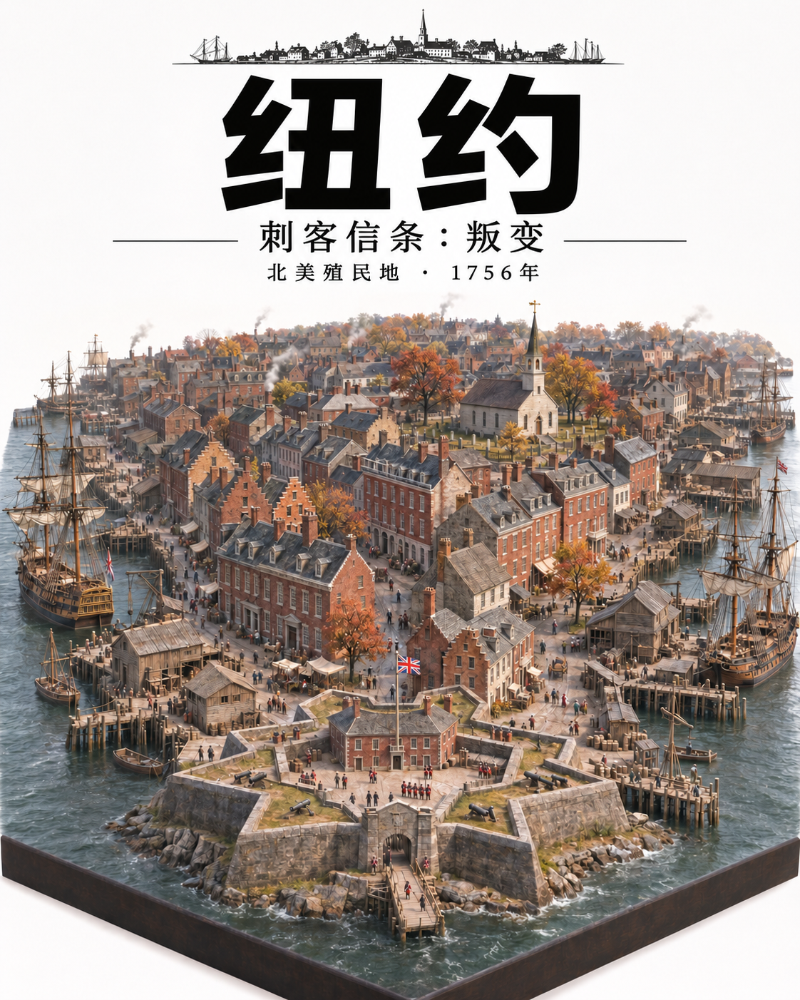</a> |  |

[中文编辑提示词](../prompts/city-miniature-poster/ac-07-new-york-zh.json) · [英文生成提示词](../prompts/city-miniature-poster/ac-07-new-york.json)

### 08 · 巴黎 · 刺客信条：大革命

| 中文版 | 英文版 |
| --- | --- |
|  |  |

[中文编辑提示词](../prompts/city-miniature-poster/ac-08-paris-zh.json) · [英文生成提示词](../prompts/city-miniature-poster/ac-08-paris.json)

### 09 · 伦敦 · 刺客信条：枭雄

| 中文版 | 英文版 |
| --- | --- |
| <a href="../images/city-miniature-posters/ac-09-london-zh.png">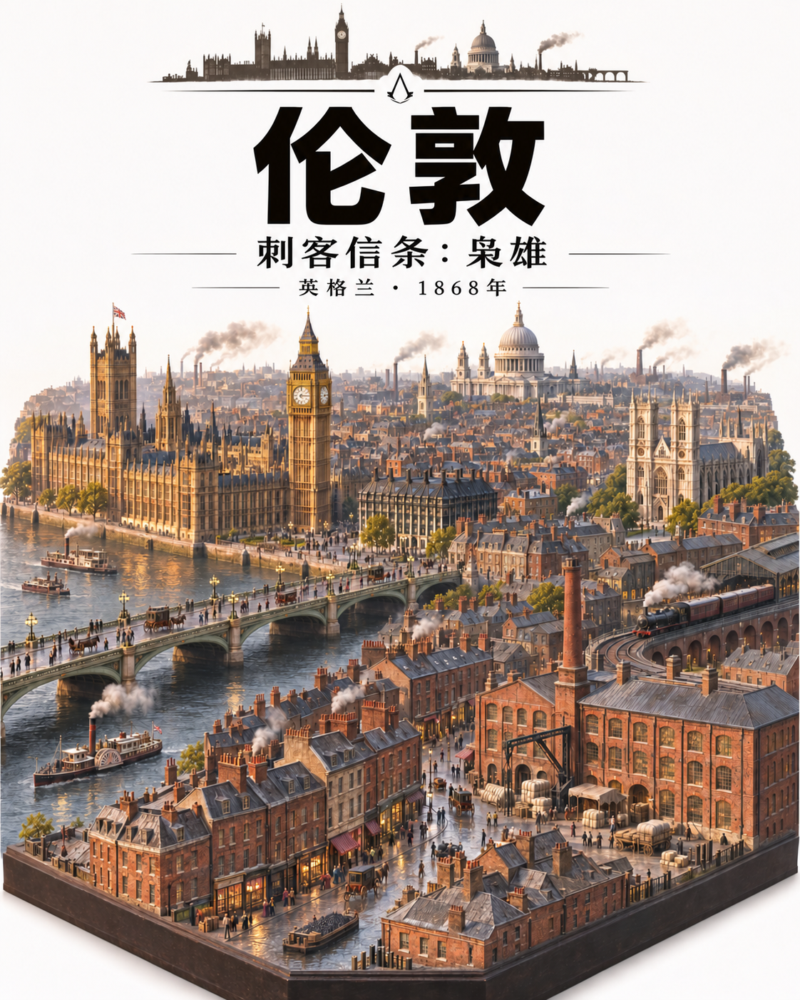</a> | <a href="../images/city-miniature-posters/ac-09-london.png">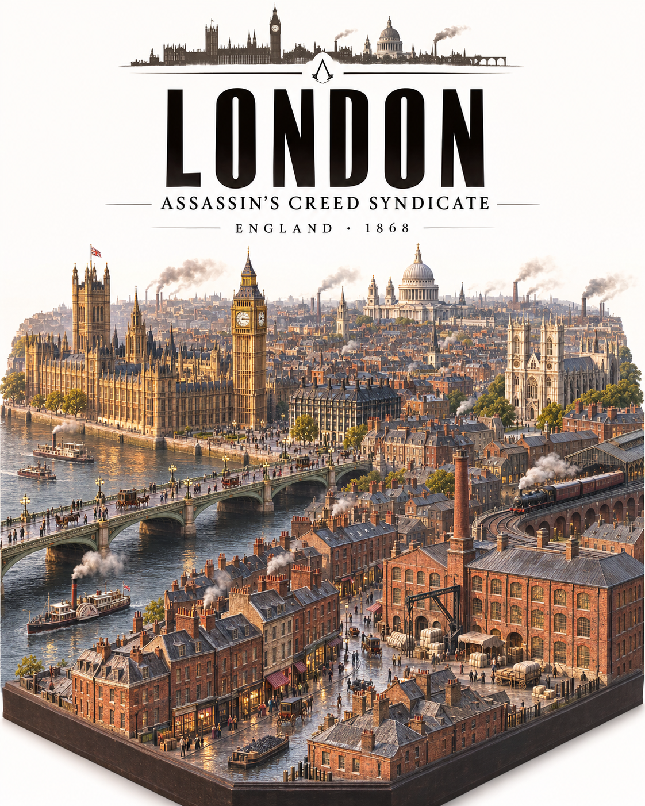</a> |

[中文编辑提示词](../prompts/city-miniature-poster/ac-09-london-zh.json) · [英文生成提示词](../prompts/city-miniature-poster/ac-09-london.json)

### 10 · 亚历山大 · 刺客信条：起源

| 中文版 | 英文版 |
| --- | --- |
|  | <a href="../images/city-miniature-posters/ac-10-alexandria.png">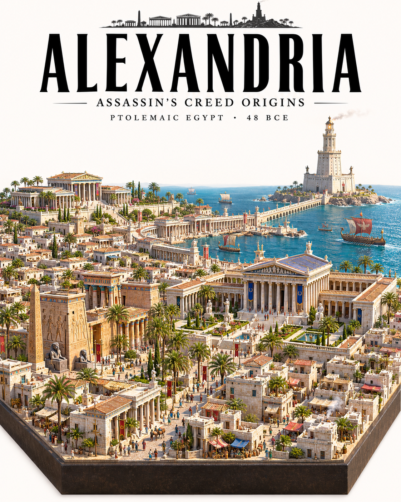</a> |

[中文编辑提示词](../prompts/city-miniature-poster/ac-10-alexandria-zh.json) · [英文生成提示词](../prompts/city-miniature-poster/ac-10-alexandria.json)

### 11 · 雅典 · 刺客信条：奥德赛

| 中文版 | 英文版 |
| --- | --- |
| <a href="../images/city-miniature-posters/ac-11-athens-zh.png">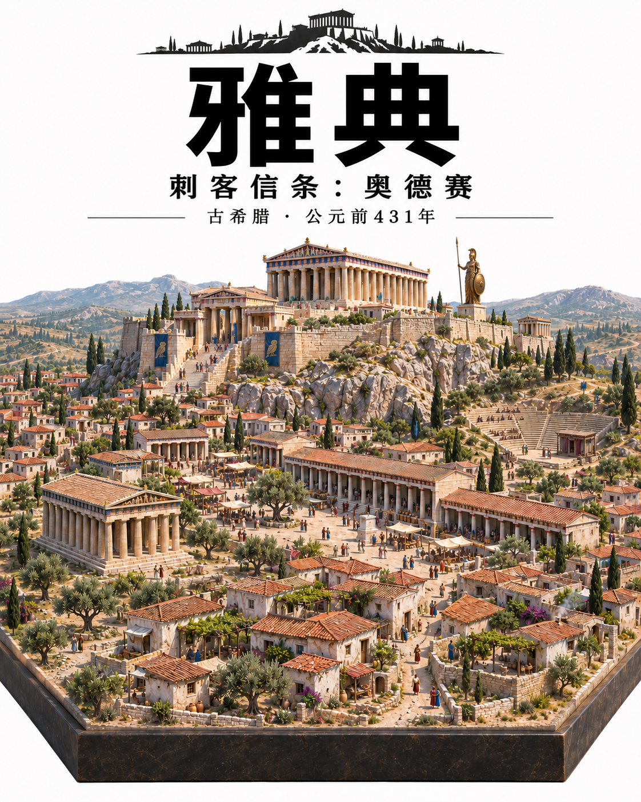</a> |  |

[中文编辑提示词](../prompts/city-miniature-poster/ac-11-athens-zh.json) · [英文生成提示词](../prompts/city-miniature-poster/ac-11-athens.json)

### 12 · 伦敦城 · 刺客信条：英灵殿

| 中文版 | 英文版 |
| --- | --- |
| <a href="../images/city-miniature-posters/ac-12-lunden-zh.png">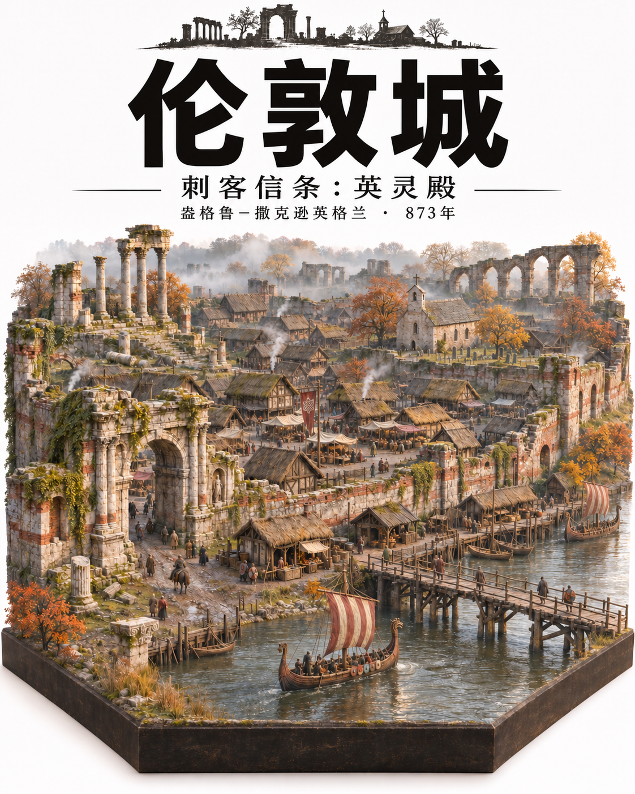</a> |  |

[中文编辑提示词](../prompts/city-miniature-poster/ac-12-lunden-zh.json) · [英文生成提示词](../prompts/city-miniature-poster/ac-12-lunden.json)

### 13 · 巴格达 · 刺客信条：幻景

| 中文版 | 英文版 |
| --- | --- |
|  |  |

[中文编辑提示词](../prompts/city-miniature-poster/ac-13-baghdad-zh.json) · [英文生成提示词](../prompts/city-miniature-poster/ac-13-baghdad.json)

### 14 · 京都 · 刺客信条：影

| 中文版 | 英文版 |
| --- | --- |
|  |  |

[中文编辑提示词](../prompts/city-miniature-poster/ac-14-kyoto-zh.json) · [英文生成提示词](../prompts/city-miniature-poster/ac-14-kyoto.json)

### 15 · 威尼斯 · 刺客信条 II

| 中文版 | 英文版 |
| --- | --- |
| <a href="../images/city-miniature-posters/ac-15-venice-zh.png">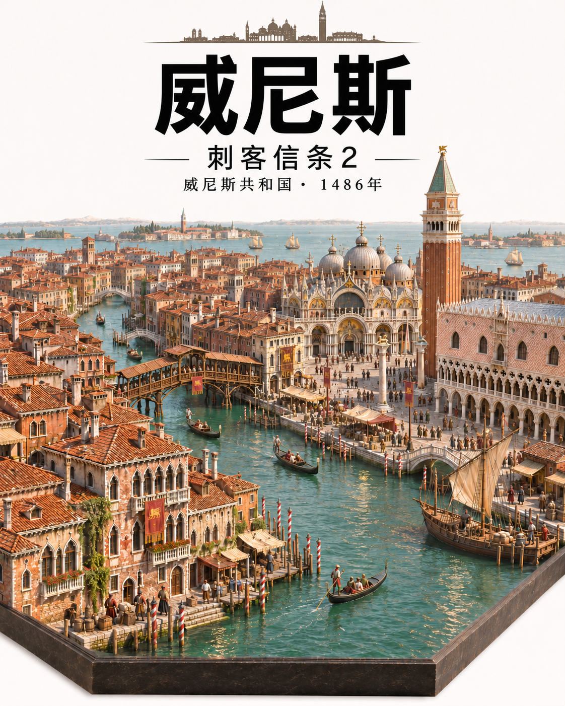</a> | <a href="../images/city-miniature-posters/ac-15-venice.png">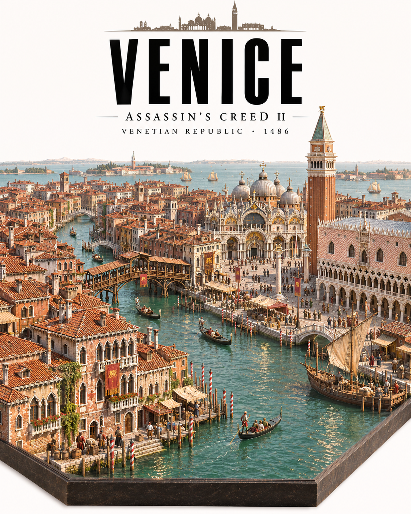</a> |

[中文编辑提示词](../prompts/city-miniature-poster/ac-15-venice-zh.json) · [英文生成提示词](../prompts/city-miniature-poster/ac-15-venice.json)

### 16 · 大马士革 · 刺客信条

| 中文版 | 英文版 |
| --- | --- |
|  |  |

[中文编辑提示词](../prompts/city-miniature-poster/ac-16-damascus-zh.json) · [英文生成提示词](../prompts/city-miniature-poster/ac-16-damascus.json)

### 17 · 阿卡 · 刺客信条

| 中文版 | 英文版 |
| --- | --- |
| <a href="../images/city-miniature-posters/ac-17-acre-zh.png">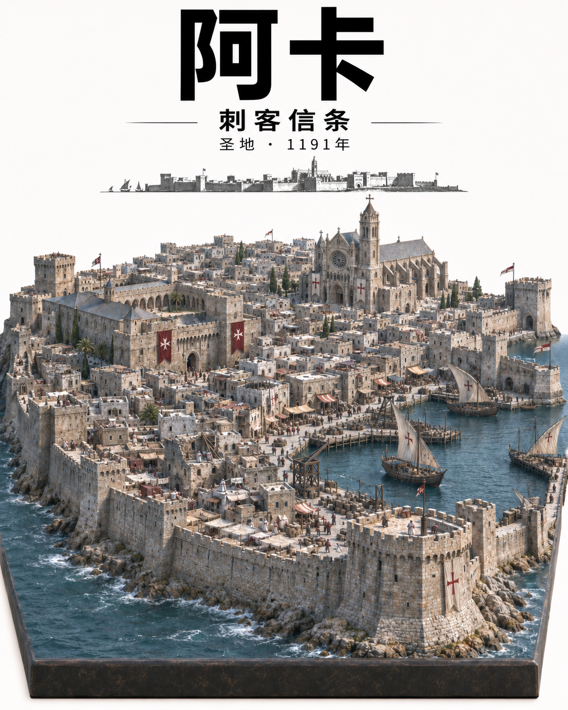</a> | <a href="../images/city-miniature-posters/ac-17-acre.png">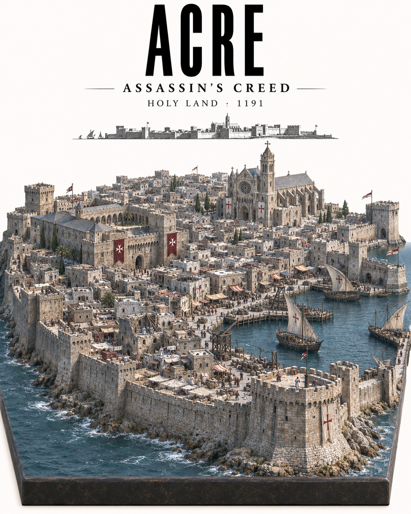</a> |

[中文编辑提示词](../prompts/city-miniature-poster/ac-17-acre-zh.json) · [英文生成提示词](../prompts/city-miniature-poster/ac-17-acre.json)

### 18 · 拿骚 · 刺客信条 IV：黑旗

| 中文版 | 英文版 |
| --- | --- |
|  | <a href="../images/city-miniature-posters/ac-18-nassau.png">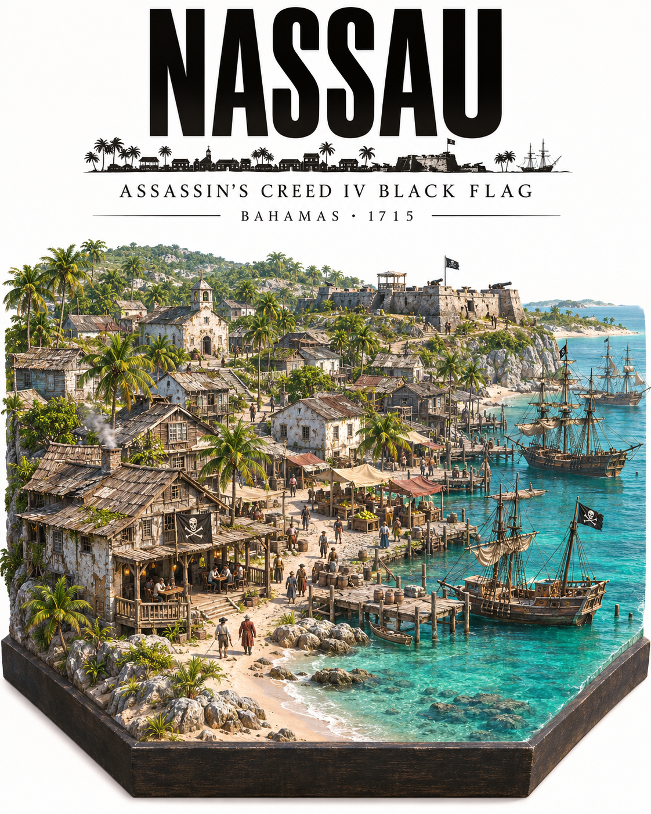</a> |

[中文编辑提示词](../prompts/city-miniature-poster/ac-18-nassau-zh.json) · [英文生成提示词](../prompts/city-miniature-poster/ac-18-nassau.json)

## 选题来源与检查

- [系列现状与重制版说明](https://news.ubisoft.com/en-us/article/62QaxfV8LiDWqVSoyROYFA/assassins-creed-fall-2026-update)
- [主作发行顺序与背景汇总](https://www.gamesradar.com/games/assassins-creed-games-in-order/)
- [《起源》中的亚历山大](https://news.ubisoft.com/en-au/article/7C3US71JxKxXH5HgoP3n6n/assassins-creed-odyssey-and-origins-featured-at-museum-of-cycladic-art-of-athens)
- [《奥德赛》的古雅典](https://news.ubisoft.com/en-us/article/4FMb4TjIOvy3DB4WlLfLGE/assassins-creed-odyssey-the-secrets-of-ancient-greece-uncovered-video-series)
- [《幻景》的巴格达与年代](https://news.ubisoft.com/en-us/article/OdmNeoYjCSPewU2FGDBDZ/assassins-creed-mirage-the-evolution-of-the-brotherhood)
- [《影》的京都街区](https://www.ubisoft.com/en-us/game/assassins-creed/news/4TA6gKaTvtOC1mOjZIxCZd)
- [育碧：系列主作顺序，初代的三座城市](https://news.ubisoft.com/en-gb/article/6ceMaQ0MpYMPeN1mJxXlLF/how-to-play-the-assassins-creed-games-in-order)
- [育碧：《刺客信条 II》的威尼斯](https://news.ubisoft.com/en-us/article/3RoepTSzG2cgj4m1JUe7YY/assassins-creed-ii-ezios-first-adventure-still-shines-on-ubisoft)
- [育碧：《黑旗》中的拿骚](https://www.ubisoft.com/en-gb/game/assassins-creed/news/2oPcDipsbvMkhlZ3BdOCXj/discover-the-fulllife-x-assassins-creed-black-flag-collection)

已逐张检查新增英文图和全部中文版的标题、游戏名、年代、构图与风格。原始 PNG 未重编码；图片尺寸、复制 SHA-256 和相对链接已核对。中文与英文是独立版本，不覆盖旧图。

细部保留艺术化近似，例如罗马桥上雕像、巴格达装饰砖面、雅典剧场座席；新增四城也不声称逐栋建筑严格符合所标年份。部分原图的标题顶部留白较紧。
