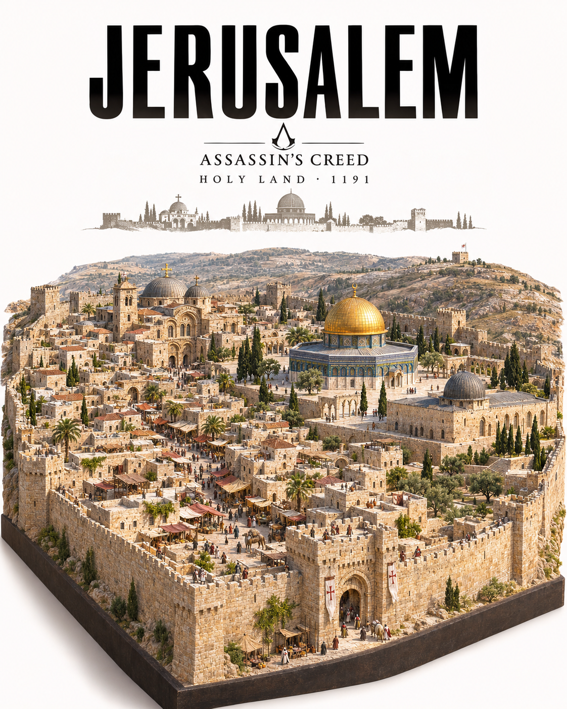
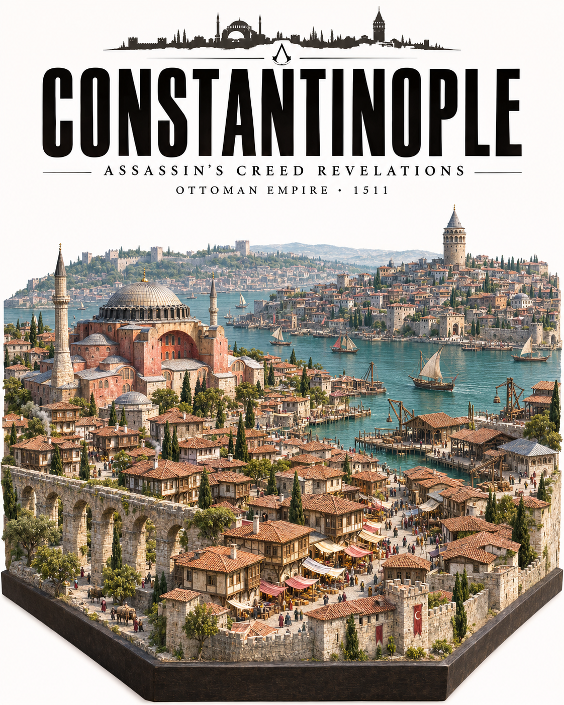
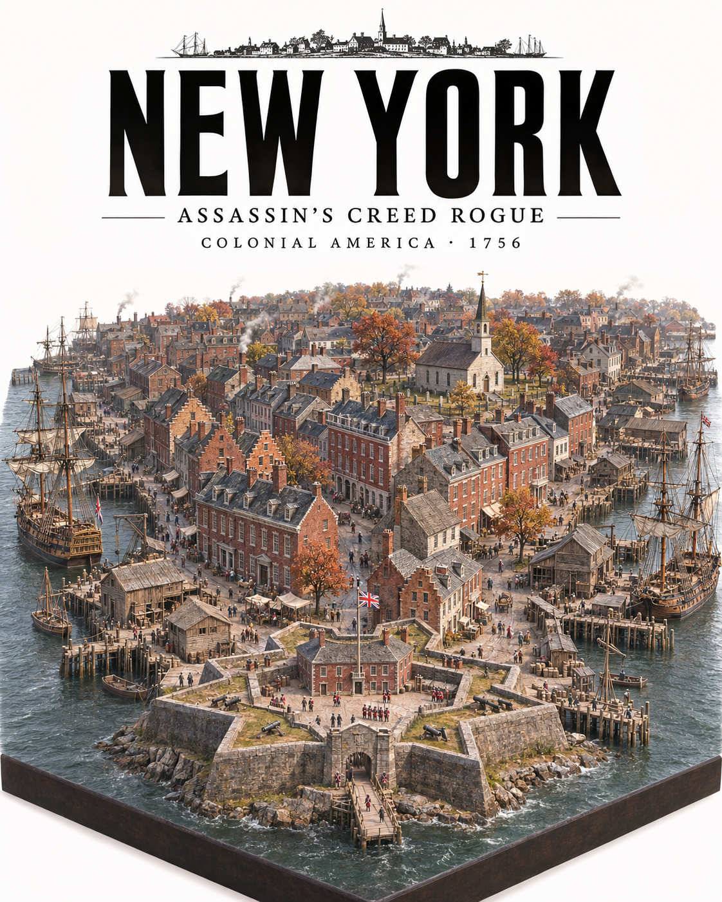
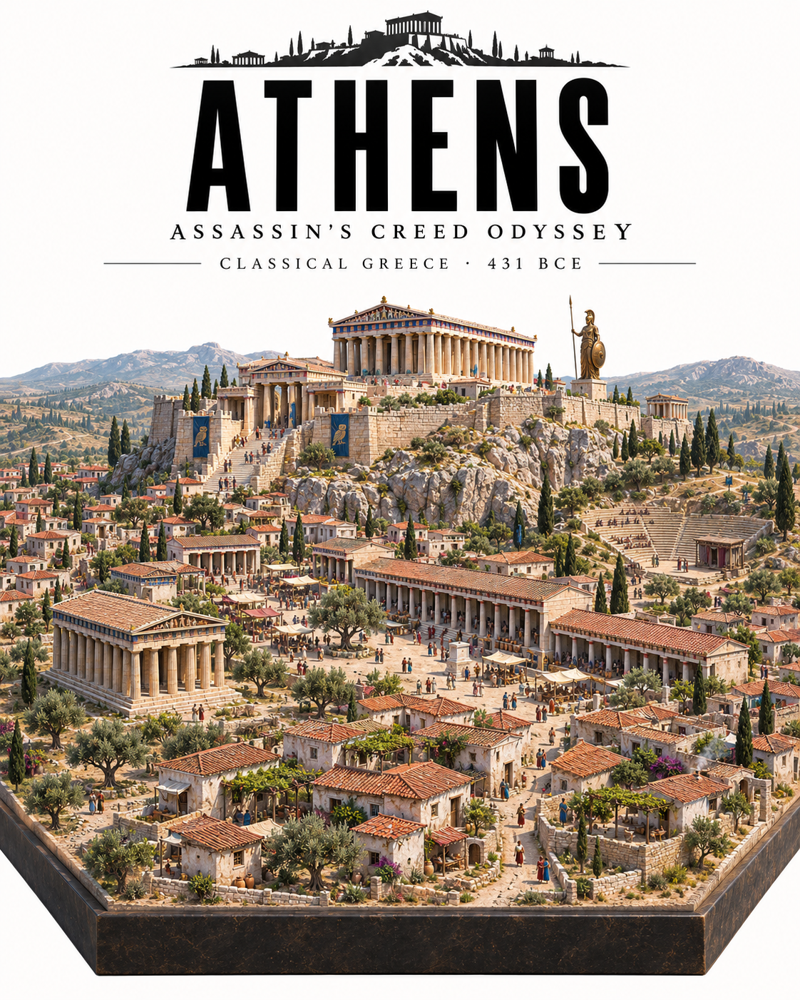
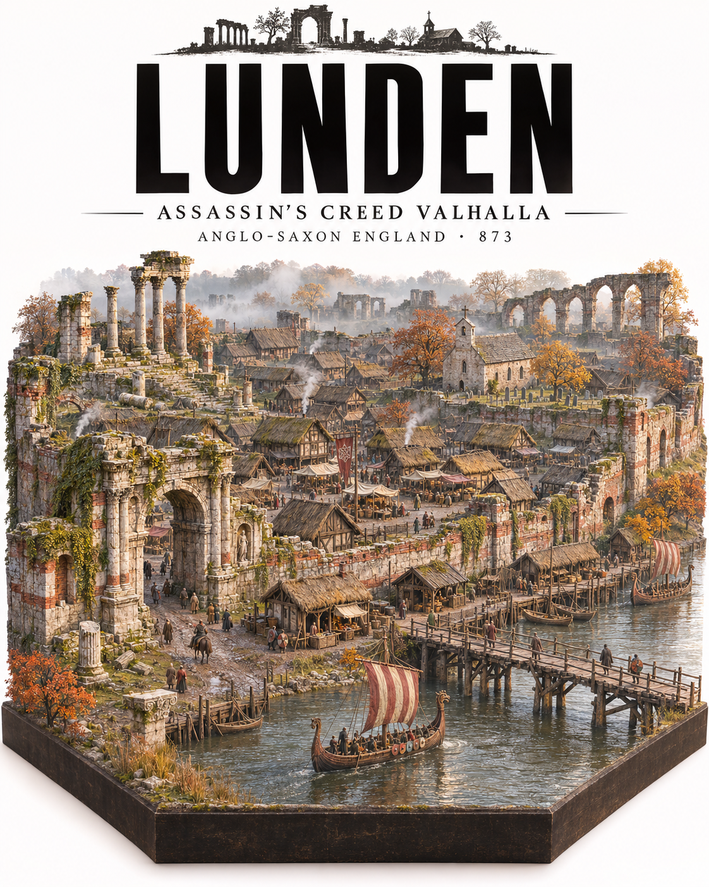
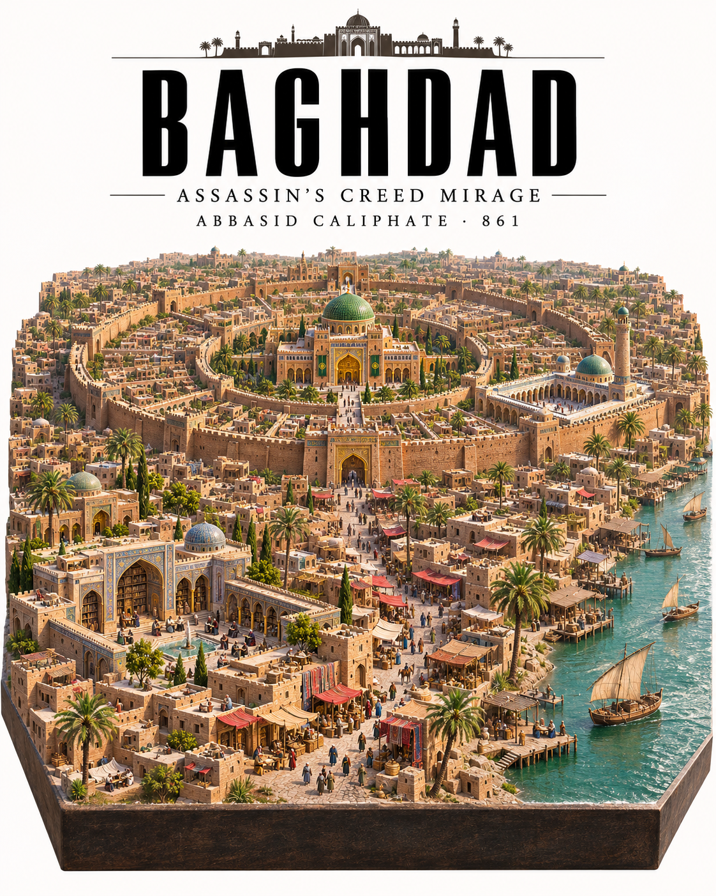
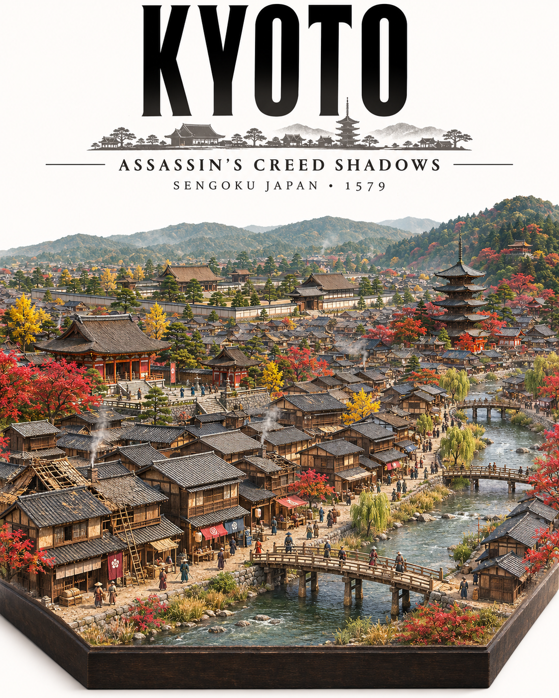

# 刺客信条：历代主作代表城市

14 张独立城市微缩海报，采用风格 3「高细节城市微缩海报」，由内置 `image_gen` 逐张生成，原图均为 1122 × 1402 PNG。

每部原版主作选取一座代表城市，从《刺客信条》至《影》；多城市作品的选取是本图集的策划选择，不表示游戏只有一座主城。重制版、DLC 与外传不重复计入。《英灵殿》选择 Lunden，而非定居点 Ravensthorpe；《枭雄》的伦敦单独表现为 1868 年。

图像属于游戏背景启发的艺术化微缩表现，压缩城市地理关系。建筑细部、装饰与年代存在生成式近似，不作为游戏地图复刻或考古复原。画面年份是所选场景时间点，不是游戏发行年或完整剧情时间范围。

[完整实际提示词](assassins-creed-city-prompts.json) · [图片清单与校验](assassins-creed-cities.json) · [风格参考](../styles/city-miniature-poster-reference.png)

## 全部作品

| 序号 | 主作 | 代表城市 | 场景年代 | 原图与提示词 |
| --- | --- | --- | --- | --- |
| 01 | 刺客信条 | 耶路撒冷 | HOLY LAND · 1191 | [原图](../images/city-miniature-posters/ac-01-jerusalem.png) · [提示词](../prompts/city-miniature-poster/ac-01-jerusalem.json) |
| 02 | 刺客信条 II | 佛罗伦萨 | ITALY · 1476 | [原图](../images/city-miniature-posters/ac-02-florence.png) · [提示词](../prompts/city-miniature-poster/ac-02-florence.json) |
| 03 | 刺客信条：兄弟会 | 罗马 | ITALY · 1500 | [原图](../images/city-miniature-posters/ac-03-rome.png) · [提示词](../prompts/city-miniature-poster/ac-03-rome.json) |
| 04 | 刺客信条：启示录 | 君士坦丁堡 | OTTOMAN EMPIRE · 1511 | [原图](../images/city-miniature-posters/ac-04-constantinople.png) · [提示词](../prompts/city-miniature-poster/ac-04-constantinople.json) |
| 05 | 刺客信条 III | 波士顿 | COLONIAL AMERICA · 1773 | [原图](../images/city-miniature-posters/ac-05-boston.png) · [提示词](../prompts/city-miniature-poster/ac-05-boston.json) |
| 06 | 刺客信条 IV：黑旗 | 哈瓦那 | CARIBBEAN · 1715 | [原图](../images/city-miniature-posters/ac-06-havana.png) · [提示词](../prompts/city-miniature-poster/ac-06-havana.json) |
| 07 | 刺客信条：叛变 | 纽约 | COLONIAL AMERICA · 1756 | [原图](../images/city-miniature-posters/ac-07-new-york.png) · [提示词](../prompts/city-miniature-poster/ac-07-new-york.json) |
| 08 | 刺客信条：大革命 | 巴黎 | FRANCE · 1789 | [原图](../images/city-miniature-posters/ac-08-paris.png) · [提示词](../prompts/city-miniature-poster/ac-08-paris.json) |
| 09 | 刺客信条：枭雄 | 伦敦 | ENGLAND · 1868 | [原图](../images/city-miniature-posters/ac-09-london.png) · [提示词](../prompts/city-miniature-poster/ac-09-london.json) |
| 10 | 刺客信条：起源 | 亚历山大 | PTOLEMAIC EGYPT · 48 BCE | [原图](../images/city-miniature-posters/ac-10-alexandria.png) · [提示词](../prompts/city-miniature-poster/ac-10-alexandria.json) |
| 11 | 刺客信条：奥德赛 | 雅典 | CLASSICAL GREECE · 431 BCE | [原图](../images/city-miniature-posters/ac-11-athens.png) · [提示词](../prompts/city-miniature-poster/ac-11-athens.json) |
| 12 | 刺客信条：英灵殿 | 伦敦城 | ANGLO-SAXON ENGLAND · 873 | [原图](../images/city-miniature-posters/ac-12-lunden.png) · [提示词](../prompts/city-miniature-poster/ac-12-lunden.json) |
| 13 | 刺客信条：幻景 | 巴格达 | ABBASID CALIPHATE · 861 | [原图](../images/city-miniature-posters/ac-13-baghdad.png) · [提示词](../prompts/city-miniature-poster/ac-13-baghdad.json) |
| 14 | 刺客信条：影 | 京都 | SENGOKU JAPAN · 1579 | [原图](../images/city-miniature-posters/ac-14-kyoto.png) · [提示词](../prompts/city-miniature-poster/ac-14-kyoto.json) |

## 图集预览

| 耶路撒冷 · 刺客信条 | 佛罗伦萨 · 刺客信条 II |
| --- | --- |
|  |  |

| 罗马 · 刺客信条：兄弟会 | 君士坦丁堡 · 刺客信条：启示录 |
| --- | --- |
|  |  |

| 波士顿 · 刺客信条 III | 哈瓦那 · 刺客信条 IV：黑旗 |
| --- | --- |
|  |  |

| 纽约 · 刺客信条：叛变 | 巴黎 · 刺客信条：大革命 |
| --- | --- |
|  |  |

| 伦敦 · 刺客信条：枭雄 | 亚历山大 · 刺客信条：起源 |
| --- | --- |
|  |  |

| 雅典 · 刺客信条：奥德赛 | 伦敦城 · 刺客信条：英灵殿 |
| --- | --- |
|  |  |

| 巴格达 · 刺客信条：幻景 | 京都 · 刺客信条：影 |
| --- | --- |
|  |  |

## 选题核对来源

资料用于核对系列范围与城市背景，具体画面构图为本图集创作。

- [系列现状与重制版说明](https://news.ubisoft.com/en-us/article/62QaxfV8LiDWqVSoyROYFA/assassins-creed-fall-2026-update)
- [主作发行顺序与背景汇总](https://www.gamesradar.com/games/assassins-creed-games-in-order/)
- [《起源》中的亚历山大](https://news.ubisoft.com/en-au/article/7C3US71JxKxXH5HgoP3n6n/assassins-creed-odyssey-and-origins-featured-at-museum-of-cycladic-art-of-athens)
- [《奥德赛》的古雅典](https://news.ubisoft.com/en-us/article/4FMb4TjIOvy3DB4WlLfLGE/assassins-creed-odyssey-the-secrets-of-ancient-greece-uncovered-video-series)
- [《幻景》的巴格达与年代](https://news.ubisoft.com/en-us/article/OdmNeoYjCSPewU2FGDBDZ/assassins-creed-mirage-the-evolution-of-the-brotherhood)
- [《影》的京都街区](https://www.ubisoft.com/en-us/game/assassins-creed/news/4TA6gKaTvtOC1mOjZIxCZd)

## 检查记录

- 14 张逐张查看：城市名、游戏标题和场景年份可读；核心地标、街区和整体风格符合图集主题。
- 模型主体均可见；部分画面的侧边城市延伸至画幅边缘，京都标题顶部留白较紧。
- 保留艺术化细节：例如罗马桥上雕像、巴格达装饰砖面、雅典剧场座席等不用于严格年代判断。
- 原始 PNG 未重编码；复制源与项目文件的 SHA-256 一致，尺寸和索引链接完成机械核对。
