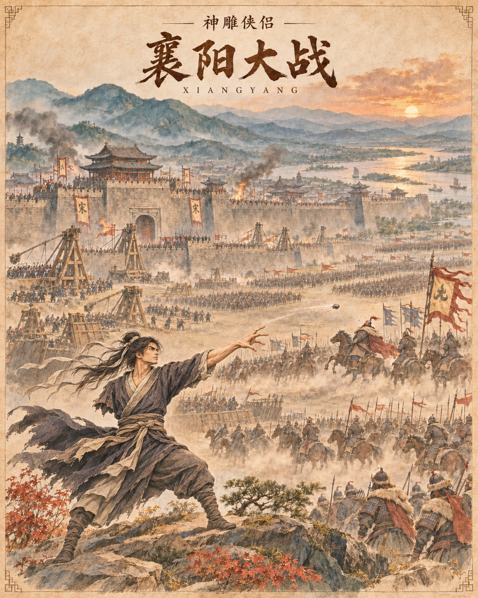
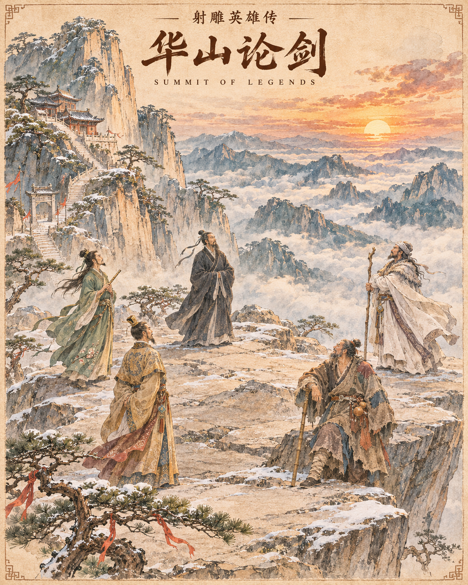
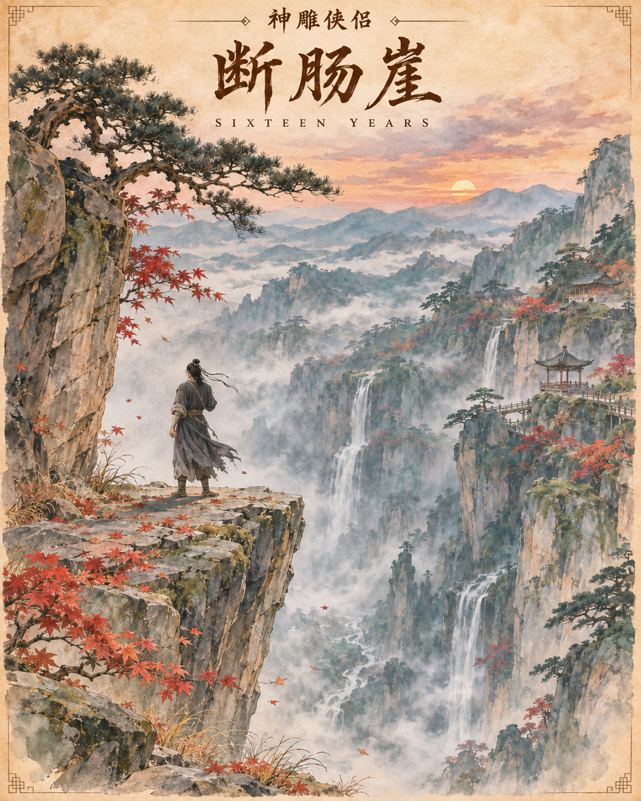
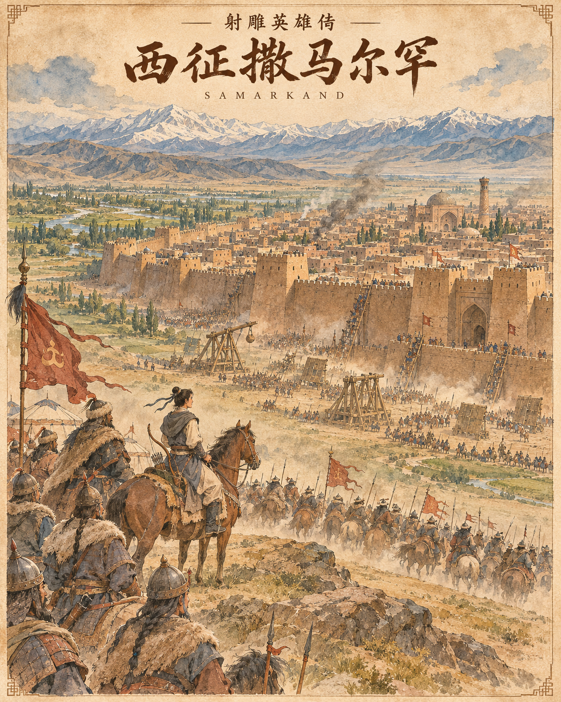
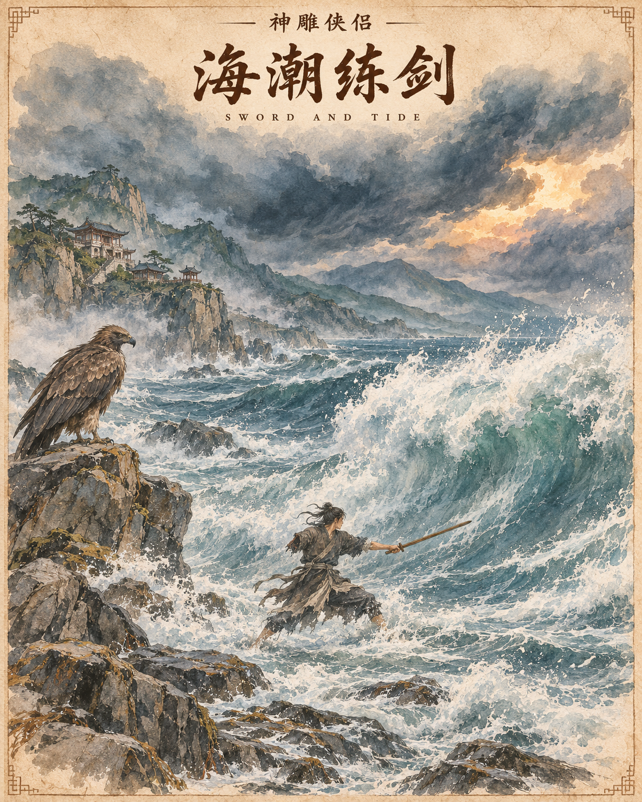
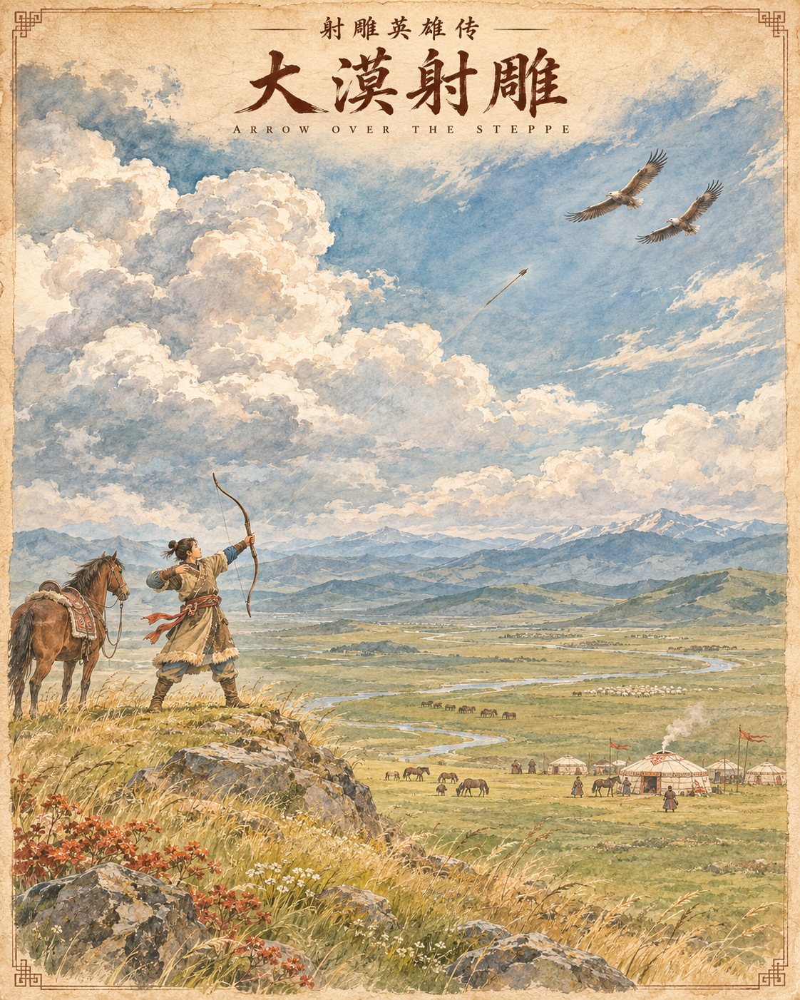
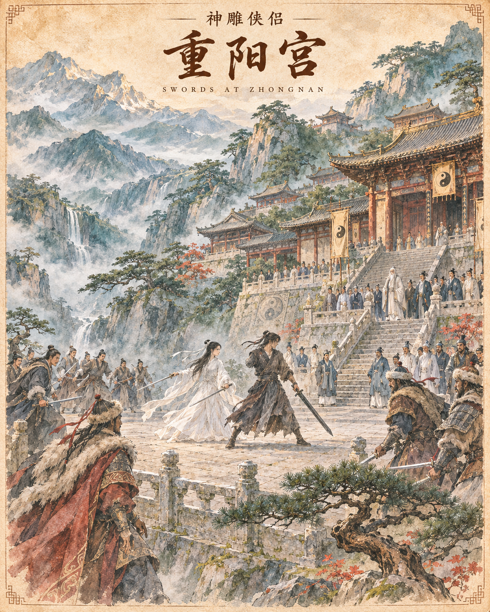
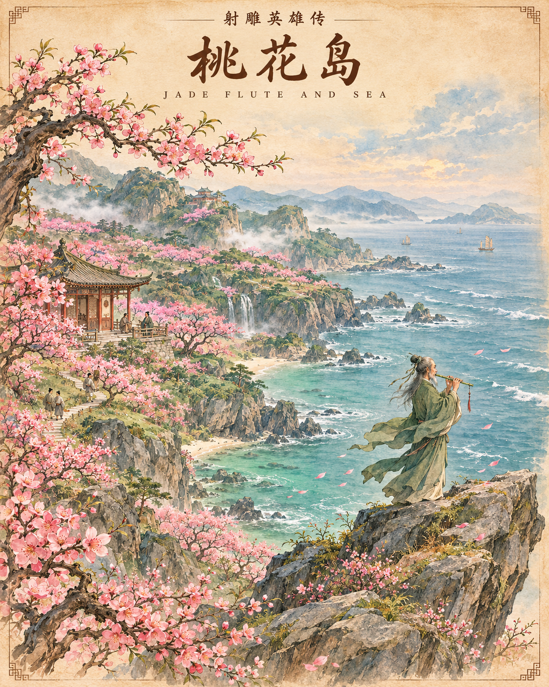

# 射雕与神雕·江湖八景

风格 4：复古水彩。八张独立海报，均为 1122 × 1402 像素，采用暖旧纸、矿物色水彩和中文题名。

[完整清单与校验](condor-heroes-watercolor.json) · [初始提示词](condor-heroes-prompts.json) · [局部修正提示词](condor-heroes-edit-prompts.json)

| 《神雕侠侣》 | 《射雕英雄传》 |
| --- | --- |
| **襄阳大战**  [实际提示词](../prompts/vintage-watercolor-travel-collage/sd-01-xiangyang-battle-v2.json) | **华山论剑**  [实际提示词](../prompts/vintage-watercolor-travel-collage/sd-05-mount-hua.json) |
| **断肠崖**  [实际提示词](../prompts/vintage-watercolor-travel-collage/sd-02-heartbreak-cliff-v2.json) | **西征撒马尔罕**  [实际提示词](../prompts/vintage-watercolor-travel-collage/sd-06-samarkand.json) |
| **海潮练剑**  [实际提示词](../prompts/vintage-watercolor-travel-collage/sd-03-ocean-sword.json) | **大漠射雕**  [实际提示词](../prompts/vintage-watercolor-travel-collage/sd-07-steppe-eagles.json) |
| **重阳宫**  [实际提示词](../prompts/vintage-watercolor-travel-collage/sd-04-chongyang-palace.json) | **桃花岛**  [实际提示词](../prompts/vintage-watercolor-travel-collage/sd-08-peach-blossom-island.json) |

## 场景说明

- 八张均为小说场景的艺术化演绎，建筑布局、地理距离与人物比例服务于构图。
- 初选清单中的“郭靖钱塘观潮悟掌”未找到可靠原著依据，已更正为“大漠射雕”。
- 华山论剑采用第一次五绝聚会的意象；段智兴以南帝身份出现。
- 海潮练剑采用木剑；襄阳大战与断肠崖初稿的手臂左右关系已通过 image_gen 修正。
- 风格依据项目已有水彩模板，以文字提示词生成；未把风格参考图作为工具图片输入。

资料核对：[《神雕侠侣》第三十二回](https://shendiao.5000yan.com/42000.html) · [美术报：金庸与故乡](https://msb.zjol.com.cn/html/2024-03/30/content_4217750.htm?div=-1)。

## 保留的初稿

两张被修正的初稿保存在 [variants/condor-heroes](../images/variants/condor-heroes/)，完整原始字节与校验值保留，不计入八张最终作品。
